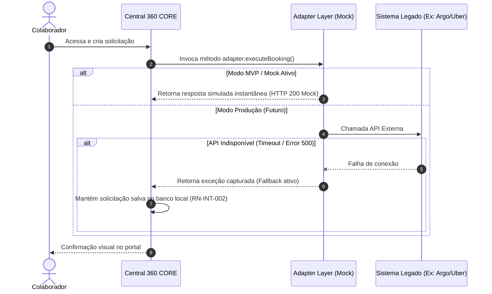

# Matriz de Integrações e Adaptadores (MVP vs. Target)

## 1. Mapeamento dos Sistemas Externos

| Sistema Externo | Frente de Atuação | Protocolo Alvo | Modo no MVP | Condição Contratual / Técnica |
| :--- | :--- | :--- | :--- | :--- |
| **Argo / My Argo** | Viagens (Voos / Hotéis) | REST / SOAP API | **Mock Simulado** | Pendente validação de licença (RN-GER-007) |
| **Copastur** | Agência & Relatórios | REST API / SFTP | **Mock Simulado** | Pendente contrato de API (RN-VIA-007) |
| **Uber for Business** | Mobilidade Urbana | REST OAuth 2.0 | **Mock Simulado** | Pendente convênio corporativo (RN-MOB-005) |
| **Táxi Digital** | Mobilidade (Táxi) | REST API | **Mock Simulado** | Pendente viabilidade (RN-MOB-004) |
| **Senior** | Correios / RH | REST / Banco Mestre | **Mock Simulado** | Pendente validação TI (RN-COR-005) |
| **SAP ERP** | Financeiro / Custos | RFC / OData REST | **Mock Simulado** | Definir fonte mestre (RN-FIN-003, RN-FIN-004) |
| **Neonpass** | Vouchers Mobilidade | REST API | **Mock Simulado** | Avaliar substituição (RN-ECO-001) |

---

## 2. Estratégia de Fallback do Adaptador Mock (RN-INT-002 / RN-INT-004)

