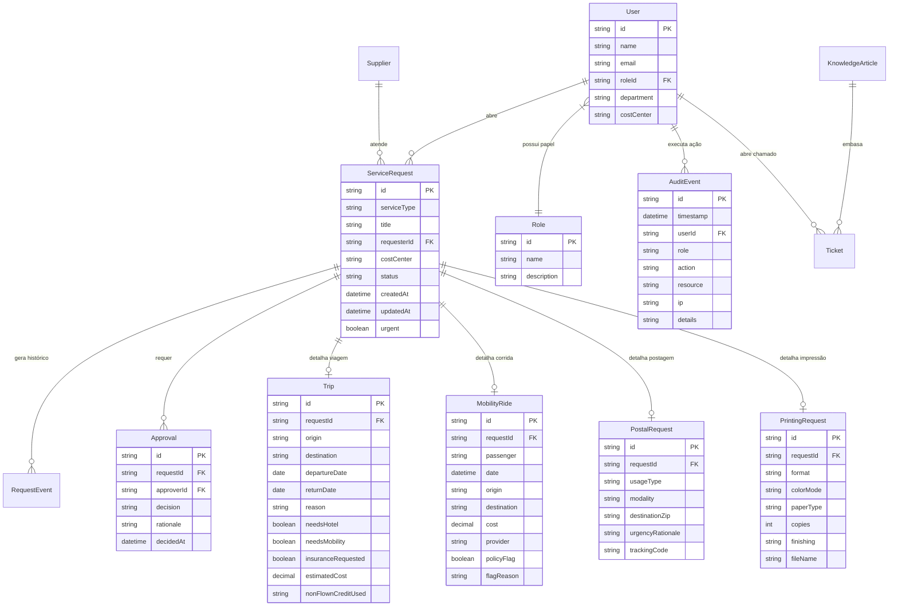

# Modelo de Dados Conceitual: Central de Serviços 360

## 1. Diagrama Entidade-Relacionamento (Mermaid ER)

---

## 2. Dicionário das 13 Entidades Principais

1. **User**: Cadastro de colaboradores e operadores.
2. **Role**: Papel RBAC de permissões (9 perfis).
3. **ServiceRequest**: Entidade central de solicitação de serviço.
4. **RequestEvent**: Registro histórico de alteração de estados da solicitação.
5. **Trip**: Detalhamento de trechos, voos, hotéis e seguro viagem.
6. **MobilityRide**: Registro de viagens de mobilidade urbana (Uber/Táxi).
7. **PostalRequest**: Detalhes de envio postal e rastreamento.
8. **PrintingRequest**: Especificações gráficas para a central de cópias.
9. **Approval**: Registro de deliberações de gestores e justificativas.
10. **Ticket**: Chamados de atendimento humano da central.
11. **Supplier**: Cadastro de prestadores de serviço e SLAs.
12. **KnowledgeArticle**: Artigos normativos para autoatendimento e chatbot.
13. **AuditEvent**: Trilha imutável de eventos de auditoria e conformidade.
